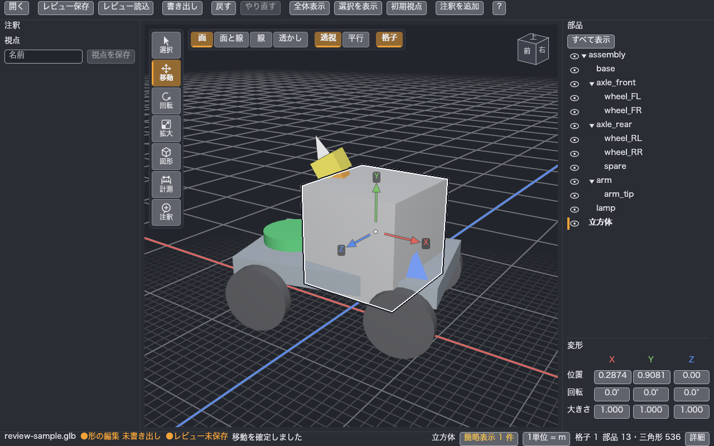

# model-reviewer

受け取った3Dモデルを確かめ、部品の位置を直して渡すための、軽いデスクトップアプリです。GLBを開き、部品を動かし、簡単な図形を足し、距離を測り、面に注釈を置いて、結果を別のGLBに書き出します。レビュー（注釈・非表示・視点）は別のJSONに保存します。頂点や面の形は編集できません。「開く」で開いたファイルは書き換えません。Rust製です。

**初期版（0.1.0）です。** 画面を動かして確かめた環境は macOS（Apple Silicon）だけです。

[English README](README.md)



## 必要なもの

- Rust（rustup）。`rust-toolchain.toml` が 1.99.0 と rustfmt・clippy を指定します。最小の対応版は 1.95 です。
- GPU と画面。Windows と Linux は、ビルドと自動テストだけを CI で確かめます。画面は未確認です。
- 画面の文字は日本語です。Linux では日本語フォント（Noto Sans CJK など）を入れてください。

## 起動

```
cargo run --release -p model-reviewer
cargo run --release -p model-reviewer -- assets/samples/review-sample.glb
```

引数は `[GLBまたはレビューJSON]`、自動操作の `--script` と `--out`、終了時に性能値を出す `--log-metrics` です。見本 `assets/samples/review-sample.glb` は自作です（作り直し方は [assets/samples/README.md](assets/samples/README.md)）。

## できること

- **見る**: 床の格子と軸、右上の向きの立方体（押すと前・右・上などへ切り替え）、透視と平行、「面」「面と線」「線」「透かし」の表示。
- **動かす**: 部品を選び、ハンドルをドラッグするか、右の「変形」の欄に数値を入れます。移動と回転は床の軸の向き、拡大は部品の軸の向きです。取り消しとやり直しができます。
- **足す・消す**: 立方体・球・円柱・平面を視点の中心に置けます。選んだ部品と子を複製・削除できます。書きかけの注釈がある部品は削除できません。
- **測る**: 2回クリックすると、2点の距離と X・Y・Z の差が出ます。ポインタは角や辺に吸い付きます（X で切り替え）。部品を動かすと距離も変わります。計測は保存しません。
- **切る**: X・Y・Z のどれかに垂直な1枚の平面で切って中を見ます。矢印のドラッグか数値で位置を決めます。
- **単位**: 状態欄の「表示 …」で、ファイルの単位・mm・cm・m を切り替えます。ファイルの単位は前提です（GLB はメートルとして読みます）。
- **残す**: 注釈、部品の非表示、名前つきの視点をレビューJSONに保存します。
- **渡す**: 「書き出し」で別名のGLBに書き出します。書き出すと、作業の対象がそのファイルに移ります。

## 画面

上部に、開く・保存・書き出し・戻す・視点のボタンがあります。3Dビューの左端に道具の列（選択・移動・回転・拡大・図形・計測・注釈）、上端に表示・投影・格子・断面の切り替え、右上に向きの立方体があります。左のパネルは注釈と視点、右のパネルは部品の一覧と「変形」の欄です。下の状態欄に、未保存の印（「形の編集 未書き出し」と「レビュー未保存」の2つ）、知らせ、距離、単位（前提と表示）、格子の間隔、部品と三角形の数が出ます。

## 操作

| したいこと | マウス・トラックパッド | キー |
|---|---|---|
| 回転 | 左ドラッグ（トラックパッドは1本指で押してドラッグ） | |
| 平行移動 | 右ドラッグか Shift＋ドラッグ（トラックパッドは2本指で押してドラッグも可） | |
| ズーム | ホイール、2本指スクロール、ピンチ | |
| 選択 | クリック | Esc で解除 |
| 全体表示／選択を表示／初期視点 | 上部のボタン | A ／ F ／ Home |
| 前・右・上から見る | 立方体の面を押す（後・左・下も） | 1 ／ 3 ／ 7 |
| 透視と平行／面と線・透かし | 3Dビュー上端のボタン | 5 ／ Z・Shift＋Z |
| 道具を選ぶ | 左端の列 | V 選択／G 移動／R 回転／S 拡大／M 計測／N 注釈 |
| 動かす・回す・拡大する | ハンドルをドラッグし、離すと確定 | ドラッグ中の Esc で取り消し |
| 数値で指定する | 「変形」の欄に入力、または欄を左右にドラッグ | Enter で確定、Esc で戻す |
| 取り消し／やり直し | 上部の「戻す」「やり直す」 | Cmd＋Z ／ Shift＋Cmd＋Z |
| 図形を足す | 左端の「図形」→ 形を押す | |
| 複製／削除 | 部品を選んでからキー | Cmd＋D ／ Delete（Backspace） |
| 距離を測る | 「計測」→ 表面を2回クリック | M、Esc で消す・終了 |
| 非表示／すべて表示 | 目の印、ボタン | H ／ Shift＋H |
| 吸着を入れる・切る | 計測の道具の横の [吸着] | X |
| 切って中を見る | 上端の [断面] | C |
| 注釈を追加 | 「注釈を追加」→ 表面をクリック | N、Enter で登録 |

中ボタンは使いません。数字は文字キーの段です。1文字のキーと Cmd＋Z は、入力欄に文字を打っている間は働きません。Windows と Linux では Cmd の代わりに Ctrl です。アプリの「?」でも同じ表を見られます。

## 対応するGLBと書き出し

読めるのは、形状がファイル内（BINチャンク）にある、圧縮していない三角形メッシュです。テクスチャ・頂点色・アニメーションなどは読み込みますが、表示は簡略にします。書き出しは元のGLBの中身（テクスチャ、アニメーション、知らない拡張を含む）を保ち、変えた所だけを直します。**削除した部品は表示から外すだけで、形状のデータはファイルに残ります**（書き出しの結果に件数を出します）。詳しくは [docs/glb.md](docs/glb.md) です。

## レビューJSON

部品の非表示、注釈、視点、元モデルの場所と識別値を保存します。復元するのは、バイト数と blake3 ハッシュが保存時と一致するモデルだけです。書き出していない形の編集があるときは、先に書き出すよう案内します。平行投影の視点を含むときだけ版2で書きます。**`path` には絶対パスが入り、ユーザー名を含むことがあります。共有する前に中身を確かめてください。** 形式は [docs/review-json.md](docs/review-json.md) です。

## 制限

- 頂点・辺・面の編集、親子の付け替え、複数選択、色と材質の編集、角度の計測、空からの新規作成、自動保存はありません。
- 吸着は、ポインタが当たっている部品の中だけで探します。断面は軸に垂直な1枚です。切り口は1色で塗るだけで、ふたと輪郭線は描きません。閉じていない形や裏返った面では、ほかの場所にも切り口の色が出ます。
- アニメーションの対象になっている部品を動かしても、再生するソフトではアニメーションの値が優先されます。スキンの付いた部品の変形は、glTF の決まりで表示に使われません。どちらも書き出しの結果に件数を出します。
- 配色は暗い1種類です。ウィンドウ設定や単位の選択は記憶しません。
- 未保存の確認は、閉じるボタン、Cmd+Q、メニューの「終了」で出ます。Dock の「終了」やログアウトでは出ません。
- 書き出しの後、使い終わったメモリはすぐにはOSへ返りません（[検証の記録](.kiro/specs/editor-foundation/verification.md)）。GPUの処理時間は測りません。

## 検証と性能

```
cargo fmt --all --check
cargo test --workspace
cargo clippy --all-targets --workspace -- -D warnings
cargo build --release
```

CI は、書式、依存のライセンス（`cargo deny`）、最小の対応版、clippy、テストを調べます。GPUを使う試験と実機の自動操作は走りません。手順と性能値の定義、測定値は [docs/verify.md](docs/verify.md) です。

## ライセンス

[MIT](LICENSE-MIT) または [Apache-2.0](LICENSE-APACHE) のどちらでも使えます。著作権表記は model-reviewer contributors です。見本のGLBも同じ条件です。提出された変更は、断りがなければ同じ二つのライセンスで提供されたものとして扱います。

依存ライブラリにはそれぞれのライセンスがあり、[deny.toml](deny.toml) で検査します。画面に使う内蔵の欧文・絵文字フォント（egui）は OFL-1.1 と Ubuntu Font Licence です。ビルド済みの実行ファイルを配る場合は、これらの表記が必要です（このリポジトリは実行ファイルをまだ配っていません）。貢献の方法は [CONTRIBUTING.md](CONTRIBUTING.md) を読んでください。
