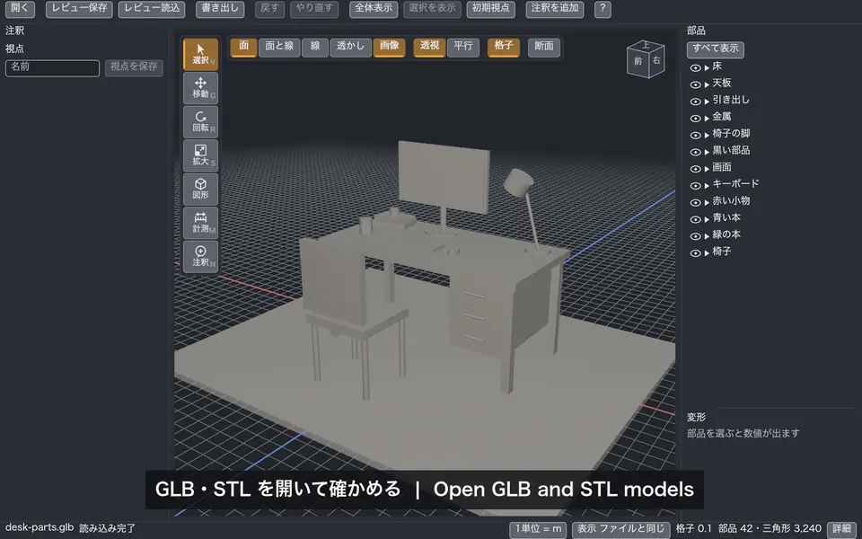

# model-reviewer

A lightweight desktop app for opening a 3D model you received (GLB or STL), checking it, moving parts or pasting images, and passing it on as GLB.

## Download

Choose the macOS universal ZIP (Apple Silicon and Intel), Windows x86-64 ZIP or Linux x86-64 tar.gz under **Assets** in the [latest release](https://github.com/haranishi/model-reviewer/releases/latest). Extract the archive and open the included sample. No Rust installation is needed.

On macOS, if the unnotarized app is blocked, choose **Privacy & Security → Open Anyway** after verifying the download. On Windows, SmartScreen may offer **More info → Run anyway** for the unsigned executable. Windows and Linux builds are experimental. Their windows have yet to be verified on physical machines. [First launch and SHA-256 checks](docs/download.md)

The interface is in Japanese. The window of the 0.1.0 source build has been tested on an Apple Silicon Mac. [Illustrated guide (Japanese)](docs/guide/README.md) · [Japanese README](README.ja.md) · [Build from source and command-line options](docs/build.md)

## What it does

- **View**: floor grid and axes, an orientation cube, perspective or orthographic projection, and four display modes (shaded, shaded with edges, wireframe, see-through).
- **View and apply textures** using embedded base-color PNG and JPEG images or your own image file. Apply an image to a part and its children using the model’s loaded UV coordinates or a repeating box projection centered on the part that keeps the image’s aspect ratio. Export embeds the image and writes box projections as UV coordinates. [Illustrated guide (Japanese)](docs/guide/12-texture.md)
- **Move**: select a part, then drag a handle or type values in the transform panel. Move and rotate follow the floor axes; scale follows the part's own axes. Undo and redo.
- **Add and remove**: add a box, sphere, cylinder or plane and set its dimensions (in mm, for example) in the Dimensions panel; selecting a part also shows its overall width, height and depth; duplicate or delete a part together with its children.
- **Measure**: click two points to get the distance and the X, Y and Z differences. The pointer snaps to corners and edges (X turns it off). Measurements are not saved.
- **Section**: cut the model with one plane perpendicular to X, Y or Z to look inside. Drag the arrow or type the position.
- Use the status bar to choose **display units** from file units, mm, cm and m. GLB uses metres. STL opens in mm with Z up. You can change either STL setting in the status bar if the file still matches what you opened.
- **Review**: save notes, hidden parts and named views to a separate review JSON file.
- **Export**: write a new GLB that keeps the original contents (textures, animations, unknown extensions) and changes only what you edited.

## Controls

| Action | Mouse / trackpad | Key |
|---|---|---|
| Orbit | Left drag | |
| Pan | Right drag, or Shift+drag | |
| Zoom | Wheel, two-finger scroll, pinch | |
| Select | Click | Esc to clear |
| Frame all / frame selection / home view | Toolbar buttons | A / F / Home |
| Front, right, top view | Click a face of the cube | 1 / 3 / 7 |
| Projection / display mode | Buttons above the view | 5 / Z, Shift+Z |
| Show or hide textures | Image button (画像) above the view | Shift+T |
| Apply / remove an image | Select a part, then drop a PNG or JPEG, or use 画像を貼る… (apply) or 画像を外す (remove) in the image panel | Cmd+T to choose an image |
| Tools | Column on the left | V select, G move, R rotate, S scale, M measure, N note |
| Undo / redo | Toolbar buttons | Cmd+Z / Shift+Cmd+Z |
| Duplicate / delete | | Cmd+D / Delete (Backspace) |
| Hide / show all | Eye icon, button | H / Shift+H |
| Snapping on / off (measure tool) | Button next to the tool column | X |
| Section view | Button above the view | C |

You can change shortcuts in the app. See [guide 09](docs/guide/09-shortcuts.md). No middle button is needed. On Windows and Linux use Ctrl instead of Cmd. Single-letter keys are ignored while you type in a text field.

## Supported GLB, STL and export

The app reads GLB files with uncompressed triangle meshes in the BIN chunk. Shaded faces show a base-color texture multiplied by the part’s color. Wireframe and see-through modes omit images. **Deleted parts’ geometry stays in the exported file.** Binary and ASCII STL files open as one part and export to GLB in metres. During the session, the app protects opened models and pasted images, including unchanged copies after a rename or move. You can export again to a GLB the app wrote. Review saves can replace an existing file only if the app can read it as a review. [GLB and texture support (Japanese)](docs/glb.md) · [STL units and export (Japanese)](docs/stl.md)

## Review JSON

Reviews store hidden parts, notes, views, and the path and fingerprint of the source model. Restoring a review requires a model with the same size and BLAKE3 hash. STL reviews also store the unit and up axis. A missing unit defaults to mm and a missing up axis defaults to Y. Review saving pauses while a replacement model loads. **`path` is an absolute path and may contain your user name. Check the file before sharing it.** [Review JSON format (Japanese)](docs/review-json.md)

## Limitations

- You can start with an empty document and change a part’s base color. Vertex, edge and face editing, reparenting, multi-selection, angle measurement and auto-save are unavailable.
- External images, KTX2, WebP, non-base-color maps, vertex colors and alpha blending are unsupported. UV coordinates and metallic/roughness values cannot be edited. Skinned or morphed parts need a loaded UV mapping to accept an image.
- Snapping only looks at the part under the pointer. The section view has a single axis-aligned plane; cut surfaces get a flat colour without caps or outlines, and open or inside-out meshes can show that colour elsewhere.
- For animated parts, playback tools use the animation values instead of your transform. glTF ignores the node transform of skinned parts. The export result counts both.
- One dark theme. Window layout and unit choice are not remembered.
- The unsaved-changes prompt appears on window close, Cmd+Q and the Quit menu, but not on Dock Quit or log out.
- Memory used during export is not returned to the OS right away. The memory figure in Details is resident memory and may not include images on the GPU. GPU time is not measured. [Texture measurements (Japanese)](docs/measurements.md)

## Development

Build and test commands are in the [build guide](docs/build.md). The [verification guide](docs/verify.md) covers GPU tests, scripted runs and measurements. Design documents live in `.kiro/specs/` and `docs/` (Japanese). [Contributing](CONTRIBUTING.md)

## License

Licensed under either of the [Apache License, Version 2.0](LICENSE-APACHE) or the [MIT license](LICENSE-MIT), at your option. The sample model is under the same terms.

Unless you explicitly state otherwise, any contribution intentionally submitted for inclusion in the work by you, as defined in the Apache-2.0 license, shall be dual licensed as above, without any additional terms or conditions.

Each download includes both project licenses and `THIRD-PARTY-LICENSES` with the dependency and embedded font notices, including the SIL Open Font License and Ubuntu Font Licence. [License policy](deny.toml)
