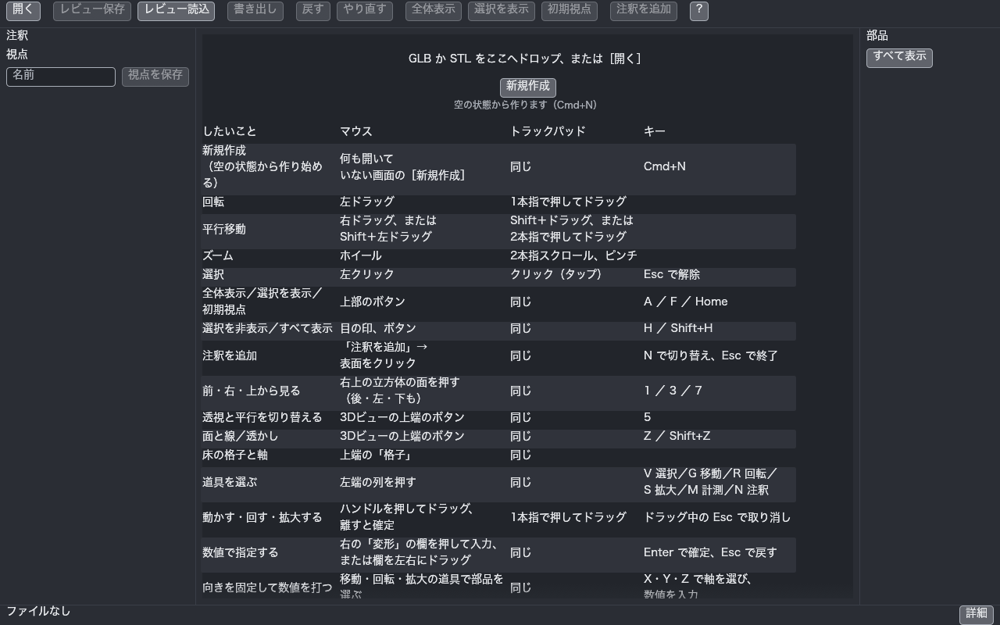

# 01　起動して見本を開く

初回は配布版を使って、付属の台車を開いてみましょう。GPU と画面を用意します。Linux では日本語フォントも必要です。[OS ごとのダウンロードと初回起動](../download.md)

## 起動から終了まで

1. 自分の OS 用の配布物をダウンロードして展開します。
2. 同梱の `START-HERE.txt` に沿ってアプリを開きます。ソースから起動する場合は[ビルド手順](../build.md)を参照してください。
3. 画面上部の「開く」を押し、展開先の `samples/review-sample.glb` を選びます。ソース版では `assets/samples` に[同じ見本](../../assets/samples/review-sample.glb)があります。中央に台車が出たら、左ドラッグで回せます。
4. 終了する前に、残したい注釈は「登録」し、下の状態欄を見ます。「形の編集 未書き出し」があれば「書き出し」、「レビュー未保存」があれば「レビュー保存」を押します。両方あるときは GLB を先に書き出します。
5. ウィンドウの閉じるボタンを押します。形やレビューの変更、入力途中の注釈が残っていると確認が出ます。作業に戻るには「やめる」、変更を捨てて閉じるには「破棄して続ける」を選びます。

## 画面

「GLB か STL をここへドロップ、または［開く］」が出たら、ファイルを選べます。「新規作成」を押して自分で形を作る手順は [11 新規作成から書き出しまで](11-create.md) にあります。

## うまくいかないとき

- 起動できない、文字が四角になる場合は [10 困ったとき](10-troubleshooting.md) を開いてください。
- macOS の Cmd+Q とメニューの「終了」は、閉じるボタンと同じ確認を通る作りです。実キーと実際のメニュー操作は未確認です。Dock の「終了」やログアウトでは確認が出ないため、先に保存してください。
