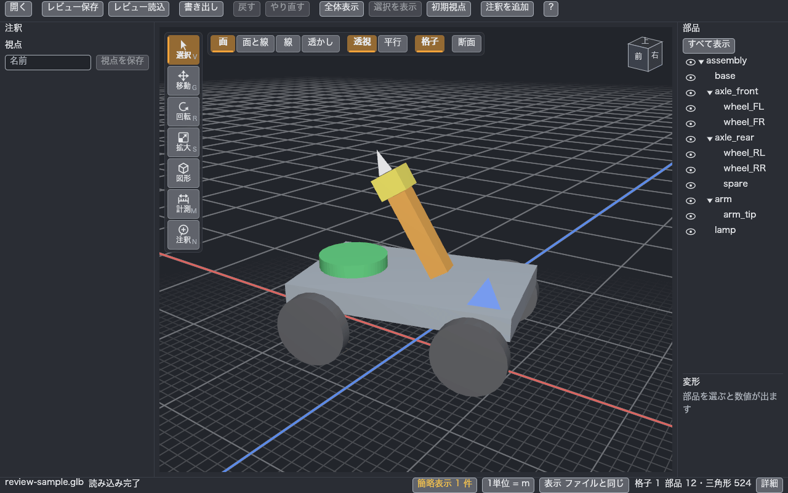
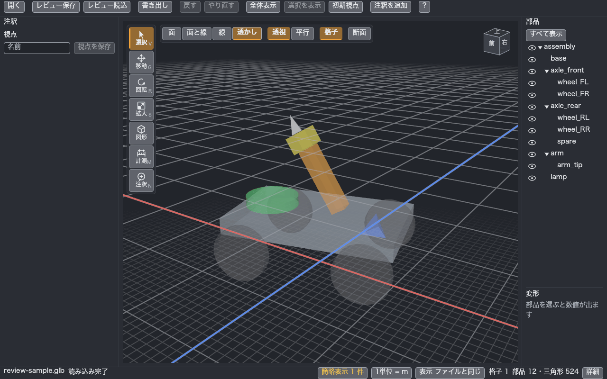

# 02　モデルを開いて見たい部品を探す

全体を見渡すには「全体表示」、小さい部品を大きく見るには、部品を選んで「選択を表示」を押します。

## 開いて向きと表示を変える

1. 上部の「開く」で GLB または STL を選びます。ファイルをウィンドウにドロップしても開けます。起動時に開くなら、ソースのフォルダで `cargo run --release -p model-reviewer -- assets/samples/review-sample.glb` を実行します。
2. 中央で左ドラッグすると回転、右ドラッグか Shift を押しながら左ドラッグすると平行移動、ホイールでズームします。トラックパッドでは1本指で押してドラッグ、Shift を押してドラッグ、2本指スクロールまたはピンチに対応します。
3. 右上の立方体で「前」「右」「上」などの面を押すと、その向きから見られます。3Dビュー上端の「透視」は遠くの物を小さく、「平行」は遠近のゆがみを付けずに描きます。
4. 上端の「面」「面と線」「線」「透かし」から選びます。奥の部品を重ねて見るには「透かし」、床の格子と軸を切り替えるには「格子」を押します。
5. 3Dビューの部品か、右の「部品」の名前を押します。一覧の開閉の印で子の部品をたどり、目の印で表示を切り替えます。親を隠すと子も隠れます。「すべて表示」で戻ります。

## 画面

## うまくいかないとき

- 視点を戻すには上部の「初期視点」を押します。「線」や「面と線」を選べないときは、その GPU で線を描けるか、ボタンにポインタを載せて理由を確かめてください。
- ファイルを開けないときは、表示された理由を[対応する GLB](../glb.md) または [STL の対応範囲](../stl.md)で確かめます。
- 実機でのトラックパッド操作、ファイルのドロップ、OS のファイル選択画面は未確認です。「開く」の代わりに手順1の起動コマンドでも見本を選べます。
