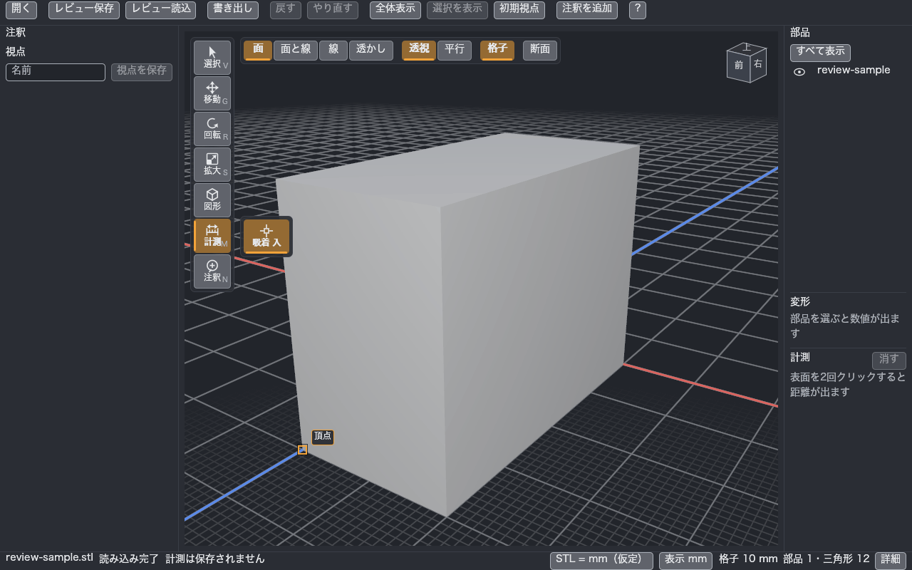
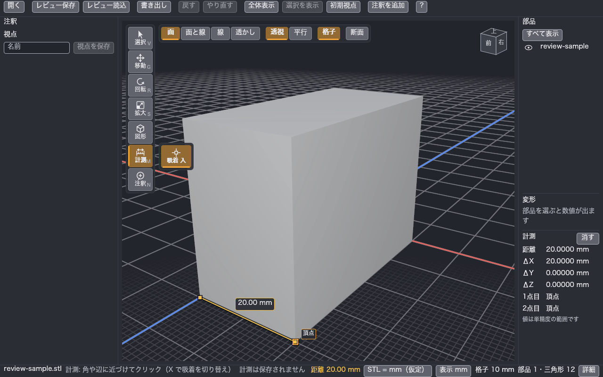

# 03　角と角の距離を測る

「計測」で表面を2回クリックすると、2点の距離が出ます。箱の幅を測るときは、両端で「頂点」の印が出てから押すと、同じ角を選び直せます。

## 箱の幅を測る

1. 「開く」で [見本の箱](../../assets/samples/review-sample.stl) を選び、3Dビュー左端の「計測」を押します。
2. 道具の横が「吸着 入」になっていることを確かめます。吸着とは、ポインタに近い角や辺に測定点を合わせる機能です。四角は「頂点」、ひし形は「辺」、丸は「面」です。
3. 幅を測りたい辺の一端で「頂点」が出たらクリックし、反対の端でも同じようにクリックします。右の「計測」にある「1点目」「2点目」で、どこに点を置いたか確認できます。
4. 「距離」は2点を結ぶ直線の長さです。「ΔX」「ΔY」「ΔZ」は、1点目から2点目までに各軸の向きに進んだ量です。見本の箱の X 方向の幅は 20 mm です。
5. 単位を替えるには下の「表示 mm」を押します。次の距離を測るには、続けて新しい1点目をクリックします。点を消すには右の「消す」、または Esc を押します。点がないときに Esc を押すと「選択」に戻ります。

## 画面

## うまくいかないとき

- 吸着はポインタが当たった部品の中で働きます。裏の部品の角を選ぶには、先に視点を回します。面の途中を測るには「吸着 入」を押して「吸着 切」にします。
- 計測点は部品と一緒に動きます。計測はレビューにも GLB にも保存されません。値を残すには、[注釈の本文](07-review.md)に書いてレビューを保存します。
