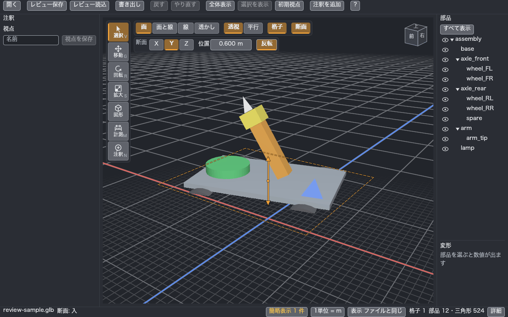

# 04　断面を開いて内側を測る

「断面」を入れると、モデルの片側を一時的に隠し、内側の表面を選んで測れます。

## 切る高さを決めて測る

1. モデルを開き、3Dビューの上端で「面」、続いて「断面」を押します。初回は Z 軸に垂直な面で中央を切ります。
2. 高さで切るには「Y」を押します。「X」「Y」「Z」で軸を替えると、切る位置はその軸の中央になります。
3. 3Dビューの矢印をドラッグします。正確に合わせるなら「位置」の欄を押し、下の状態欄と同じ表示単位で値を打って Enter を押します。「反転」で見える側を入れ替えます。
4. 左端の「計測」を押し、切ったことで見えるようになった表面を2か所クリックします。角や辺に合わせるには [03 距離を測る](03-measure.md) の印を使います。
5. 上端の「断面」をもう一度押すと全体が見えます。同じモデルでもう一度入れると、前の軸と位置で切れます。

## 画面

## うまくいかないとき

「面」「面と線」で切り口の色が付くのは、奥にある面の裏側です。切る位置にふたや輪郭線は作りません。点を置くときは、残った部品の実際の面・辺・頂点を狙います。閉じていない形や裏返った面では、切っていない所にも同じ色が出ることがあります。
