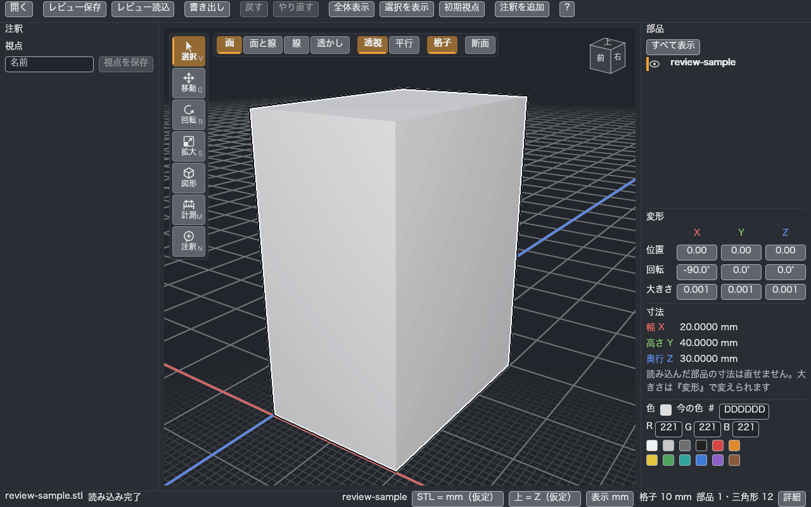

# 05　STL の寸法と上の向きを合わせる

STL には長さの単位や上の向きの決まりがありません。このアプリは mm と仮定し、Y を上にして開きます。

## 開いて寸法を確かめる

1. 「開く」で [review-sample.stl](../../assets/samples/review-sample.stl) を選びます。右の「部品」で箱を選ぶと、「寸法」に幅 20 mm、高さ 30 mm、奥行 40 mm が出ます。
2. 手元の STL が cm や m で作られていたら、編集する前に状態欄の「STL = mm（仮定）」を押します。mm からは m → cm → mm の順で、選んだ単位を使って開き直します。未保存の編集があれば確認が出ます。
3. 寸法を別の単位で読みたいだけなら、隣の「表示 mm」を押します。こちらはモデルを開き直さず、同じ長さを換算して表示します。
4. Z が上のソフトで作った部品が寝ていたら、部品を選び、「変形」の「回転」の X に `-90` を入れて Enter を押します。
5. 「書き出し」を押し、GLB の保存先を選びます。向きと大きさは GLB に引き継がれます。20 mm の幅は、メートルで読むと 0.02 m です。

## 画面

## うまくいかないとき

「変形」の「大きさ」に 0.001 と出るのは、元の mm をメートルに合わせた倍率です。実際の長さは「寸法」で確かめます。仮定を替えて開き直すと、計測、断面、取り消しの履歴は消えます。STL のまま保存する機能はありません。[STL の単位と対応範囲](../stl.md)
