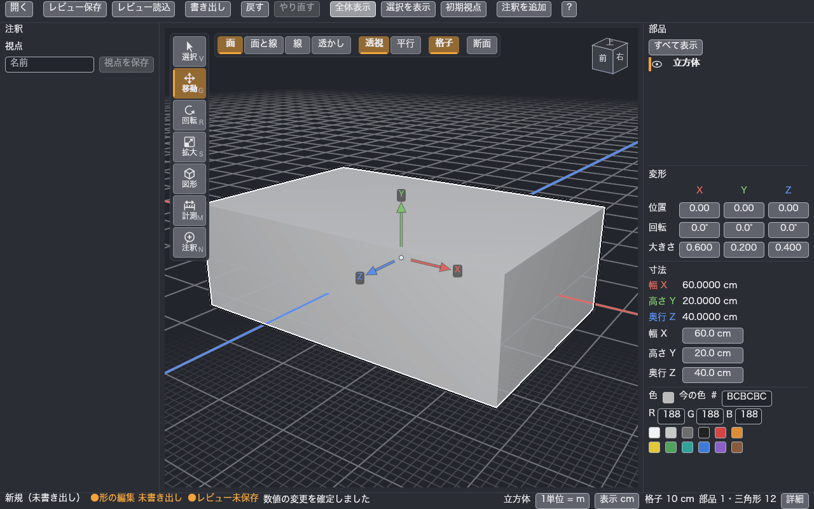

# 06　寸法を決めて図形を置く

「図形」で置いた部品は、右の「寸法」に長さを入れて大きさを決められます。例として、幅 60 cm、高さ 20 cm、奥行 40 cm の箱を作ります。

## 箱の寸法を決めて複製する

1. 空から始めるときは「新規作成」を押します。開いているモデルにも図形を足せます。[空の画面から作る手順](11-create.md)
2. 状態欄の表示単位を押して「表示 cm」にします。左端の「図形」を押し、続けて「立方体」を押します。図形は視点の中心に置かれ、選択された状態になります。
3. 右の「寸法」で、下側の入力欄に「幅 X」は `60`、「高さ Y」は `20`、「奥行 Z」は `40` と入れ、欄ごとに Enter で確定します。「球」は「直径」、「円柱」は「直径」と「高さ」、「平面」は「幅 X」と「奥行 Z」を指定できます。
4. 上部の「全体表示」で箱を画面に収めます。「寸法」の上側にある3つの値は外形です。選んだ部品とその子を囲む箱の幅・高さ・奥行を、床の軸に沿って示します。
5. 箱を選び、Cmd+D（Windows・Linux は Ctrl+D）を押します。コピーは元と重なった位置にできます。「移動」の矢印をドラッグすると、2つの箱を見分けられます。
6. 選んだコピーを消すには Delete または Backspace を押します。子の部品と、その範囲に付けた注釈も一緒に消えます。間違えたら上部の「戻す」を押します。「やり直す」で同じ変更をもう一度適用できます。

## 画面

## うまくいかないとき

- 読み込んだ部品は外形を読めます。大きさを変えるには「変形」の「大きさ」を使います。寸法を指定できない形に変形した図形は、「戻す」で編集前に戻せます。
- 寸法には 0 より大きい数を入れます。書きかけの注釈がある部品を消すときは、先に注釈を登録するか、Esc で下書きを取り消します。
