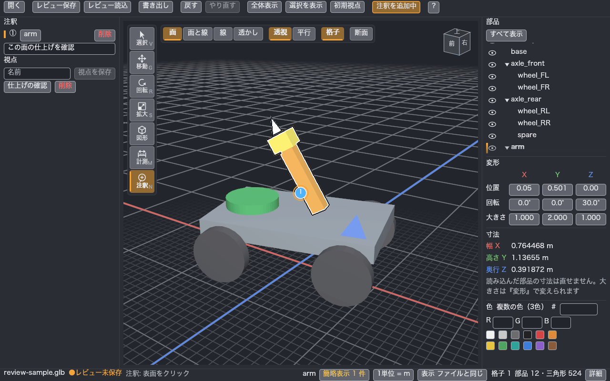

# 07　注釈と視点を保存して渡す

気になる面には注釈を付け、そこが見やすい向きには名前を付けておきます。「レビュー保存」で、注釈・視点・部品の非表示をまとめて残せます。

## 指摘を残し、後で開く

1. 上部の「注釈を追加」を押し、指摘したい表面をクリックします。「指摘を入力」に本文を打ち、「登録」または Enter で登録します。改行は Shift+Enter、下書きの取り消しは Esc です。
2. 本文を直すには、左の「注釈」で本文を押して書き換え、欄の外を押して確定します。注釈を消すには、その注釈の「削除」を押します。
3. モデルを見せたい向きに回し、左の「視点」の「名前」に、たとえば「仕上げの確認」と入れて「視点を保存」を押します。並んだ名前を押すと、その向きと距離に戻ります。
4. ファイルとして残すには、上部の「レビュー保存」を押し、JSON ファイルの保存先を選びます。「視点を保存」の後にも、この操作が必要です。新規の文書や未書き出しの編集があるときは、先に [GLB を書き出します](08-export.md)。
5. 次に開くときは「レビュー読込」で JSON を選びます。相手に渡すときは、レビューを保存した時点と同じモデルも一緒に渡します。

## 画面

**共有する前に** JSON をテキストとして開き、`model.path` を確かめてください。ここにはモデルを開いた場所が記録され、利用者名やフォルダ名が含まれることがあります。[レビューJSONに含まれる情報](../review-json.md)

## うまくいかないとき

「モデルが見つかりません」と出たら「モデルを指定…」で保存時のファイルを選びます。「モデルが一致しません」と出る場合は、名前が同じでも中身が違います。書き出した後に保存したレビューには、その書き出し先の GLB を指定してください。
