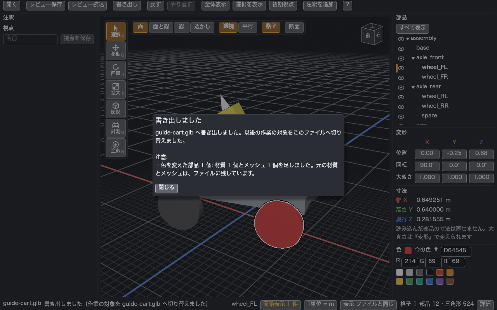

# 08　形と色を GLB に書き出す

部品の位置・寸法・基本色を渡すには「書き出し」を使います。開いた元ファイルを保ったまま、別名の GLB に編集結果を保存できます。

## 書き出して結果を確かめる

1. 部品を編集し、状態欄の「形の編集 未書き出し」を確かめます。見本で試すなら、台車の車輪を選んで右の「色」で赤い見本を押します。
2. 上部の「書き出し」を押し、元とは別の名前で GLB を保存します。新規作成からなら保存名の初期値は「無題.glb」、STL からなら元の名前の拡張子が `.glb` に替わります。
3. 書き出しが終わると、状態欄に保存先のファイル名が出ます。注意がある場合は「書き出しました」の小窓が開きます。一覧を読んで「閉じる」を押します。
4. 以後の作業の対象は、今書き出した GLB です。さらに編集して書き出すと、この GLB が土台になります。注釈や非表示の部品、視点も渡すには、ここで [レビューを保存](07-review.md) します。

## 画面

| 一覧に出る内容 | 読み方 |
|---|---|
| 色を変えた部品 | 部品の数と、足した材質・メッシュ（形状）の数です。元の材質とメッシュはファイルに残ります |
| 削除した部品 | 表示する部品から外れた数です。形状のデータ自体はファイルに残ります |
| アニメーションの対象、スキンの付いた部品 | 再生時にはアニメーションの値が優先されます。スキン（骨で変形する部品）の位置変更は再生側の表示に反映されません |
| STL からの書き出し | 元の単位と倍率を使い、ほかのソフトでメートルとして読める大きさにしたことを示します |

## うまくいかないとき

- 「開いたファイルへは書き出せません」と出たら、別の保存名を選びます。部品のない新規の文書は、図形を置いてから書き出してください。
- 色の見え方は [11 色を付けて保存する](11-create.md)、GLB が保つデータと書き出しの制限は [GLB の対応範囲](../glb.md) で確かめられます。
