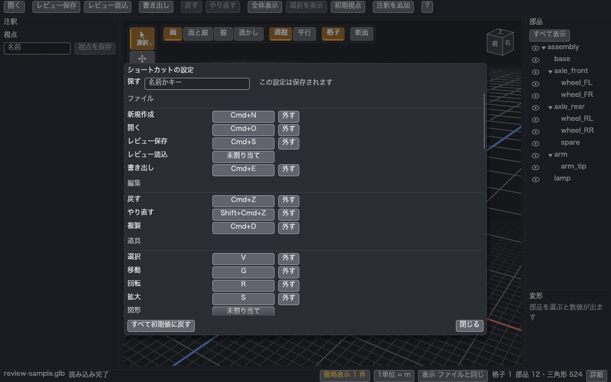
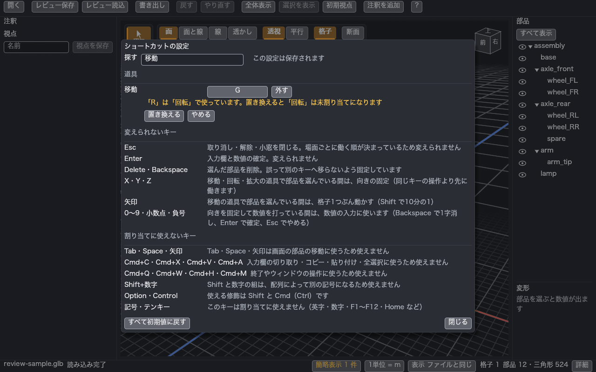

# 09　ショートカットを調べる・変える

ボタンにポインタを載せると、その操作のキーを確認できます。キーを変えるには、上部の「?」から「ショートカットの設定」を開きます。

## 「移動」のキーを変える

1. 「探す」に「移動」と入れます。操作の名前でも、今のキーでも探せます。
2. 「移動」の行で今のキー（初期値は G）を押します。「キーを押してください（Esc でやめる）」と出たら、使いたいキーを押します。たとえば T を押すと「変更」が付きます。「閉じる」の後は T で移動を選べます。
3. ほかの操作のキーを選ぶと、その操作名が出ます。「置き換える」を押すと元の操作は「未割り当て」になります。両方の割り当てを保つには「やめる」を押します。
4. キーを取り除くには「外す」、移動だけを戻すには「初期値に戻す（G）」を押します。「すべて初期値に戻す」は、確認の文に替わったボタンをもう一度押すと実行します。

割り当てには英字、文字キーの段の数字、F1〜F12、Home・End・PageUp・PageDown・Insert が使えます。Shift や Cmd（Windows・Linux は Ctrl）と組み合わせられます。Shift+数字など、使えない組と理由は小窓の「割り当てに使えないキー」にあります。

## 画面

画像には既定のキーを使います。「自動操作のため、変更は保存されません」は撮影時の表示です。

### 既定のキー

<!-- keys:begin -->
| まとまり | 画面の言葉 | macOS | Windows・Linux |
|---|---|---|---|
| ファイル | 新規作成 | Cmd+N | Ctrl+N |
| ファイル | 開く | Cmd+O | Ctrl+O |
| ファイル | レビュー保存 | Cmd+S | Ctrl+S |
| ファイル | レビュー読込 | 未割り当て | 未割り当て |
| ファイル | 書き出し | Cmd+E | Ctrl+E |
| 編集 | 戻す | Cmd+Z | Ctrl+Z |
| 編集 | やり直す | Shift+Cmd+Z | Shift+Ctrl+Z |
| 編集 | 複製 | Cmd+D | Ctrl+D |
| 道具 | 選択 | V | V |
| 道具 | 移動 | G | G |
| 道具 | 回転 | R | R |
| 道具 | 拡大 | S | S |
| 道具 | 図形 | 未割り当て | 未割り当て |
| 道具 | 計測 | M | M |
| 道具 | 注釈 | N | N |
| 道具 | 立方体を置く | 未割り当て | 未割り当て |
| 道具 | 球を置く | 未割り当て | 未割り当て |
| 道具 | 円柱を置く | 未割り当て | 未割り当て |
| 道具 | 平面を置く | 未割り当て | 未割り当て |
| 道具 | 吸着 | X | X |
| 道具 | 計測を消す | 未割り当て | 未割り当て |
| 見る | 全体表示 | A | A |
| 見る | 選択を表示 | F | F |
| 見る | 初期視点 | Home | Home |
| 見る | 前から見る | 1 | 1 |
| 見る | 右から見る | 3 | 3 |
| 見る | 上から見る | 7 | 7 |
| 見る | 後から見る | 未割り当て | 未割り当て |
| 見る | 左から見る | 未割り当て | 未割り当て |
| 見る | 下から見る | 未割り当て | 未割り当て |
| 見る | 透視と平行 | 5 | 5 |
| 表示 | 面と線 | Z | Z |
| 表示 | 透かし | Shift+Z | Shift+Z |
| 表示 | 面 | 未割り当て | 未割り当て |
| 表示 | 線 | 未割り当て | 未割り当て |
| 表示 | 格子 | 未割り当て | 未割り当て |
| 表示 | 断面 | C | C |
| 表示 | 選択を非表示 | H | H |
| 表示 | すべて表示 | Shift+H | Shift+H |
| 表示 | 表示の単位 | 未割り当て | 未割り当て |
| その他 | ヘルプ | F1 | F1 |
| その他 | ショートカットの設定 | 未割り当て | 未割り当て |
<!-- keys:end -->

### 変えられないキー

<!-- fixed:begin -->
| キー | 役目 |
|---|---|
| Esc | 取り消し・解除・小窓を閉じる。場面ごとに働く順が決まっているため変えられません |
| Enter | 入力欄と数値の確定。変えられません |
| Delete・Backspace | 選んだ部品を削除。誤って別のキーへ移らないよう固定しています |
| X・Y・Z | 移動・回転・拡大の道具で部品を選んでいる間は、向きの固定（同じキーの操作より先に働きます） |
| 矢印 | 移動の道具で部品を選んでいる間は、格子1つぶん動かす（Shift で10分の1） |
| 0〜9・小数点・負号 | 向きを固定して数値を打っている間は、数値の入力に使います（Backspace で1字消し、Enter で確定、Esc でやめる） |
<!-- fixed:end -->

回転・拡大の矢印は、軸を選んでから使います。1歩の量と数値の入れ方は [11 キーで動かす](11-create.md) にあります。

### 設定ファイルの場所

「この設定は保存されます」と出ていれば、変更のたびに次の場所へ保存します。起動時に `--keymap` でファイルを指定した場合はそちらを使います。Windows と Linux の保存先は試験でのみ確認しました。各 OS の実際の利用者設定での保存と再起動は未確認です。

| OS | 保存先 |
|---|---|
| macOS | `~/Library/Application Support/model-reviewer/keymap.json` |
| Windows | `%APPDATA%\model-reviewer\keymap.json` |
| Linux | `$XDG_CONFIG_HOME/model-reviewer/keymap.json`。保存先の指定がないか相対パスなら `~/.config/model-reviewer/keymap.json` |

## うまくいかないとき

入力中の欄を離れ、確認・ヘルプ・設定の小窓を閉じてからモデルを操作します。ボタンに入力位置がある間は、Delete・Backspace・矢印・Enter が部品の操作に届きません。キーの取り込み中に理由が出たら、別のキーを押すか Esc でやめます。実キー・日本語入力・保存の問題は [10 困ったとき](10-troubleshooting.md) を参照してください。
