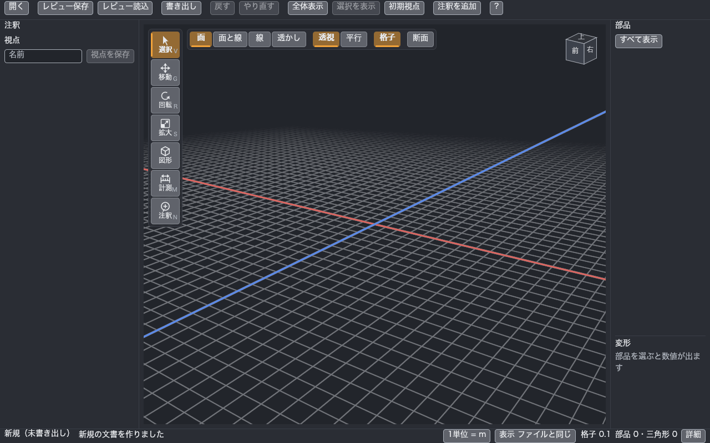
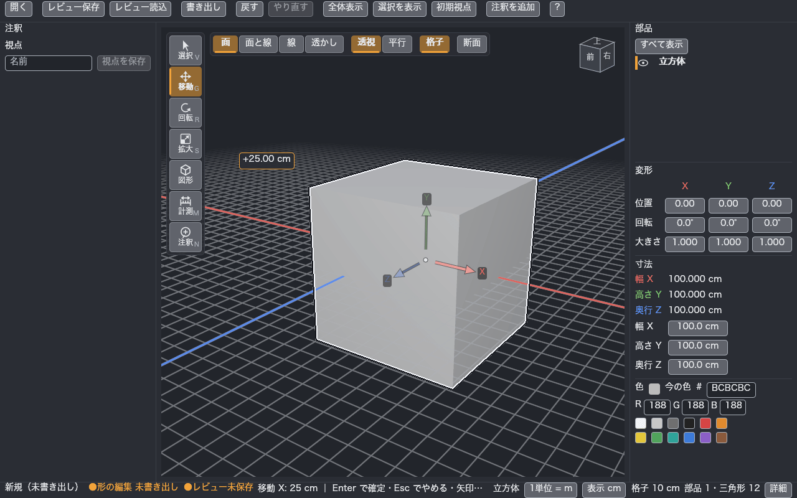
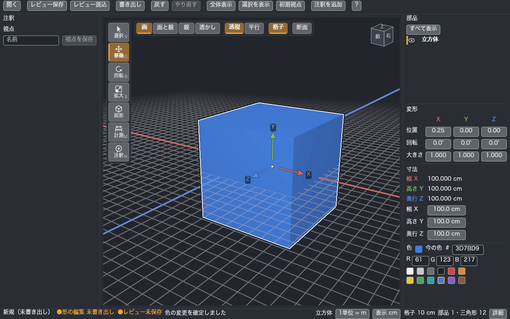

# 11　空の画面から作って保存する

青い立方体を1つ作り、X 方向に 25 cm 動かして GLB に保存します。以下のキーは初期値です。[自分のキーを調べる](09-shortcuts.md)

## 立方体を置き、キーで動かす

1. 何も開いていない画面で「新規作成」を押します。モデルを開いているときは Cmd+N（Windows・Linux は Ctrl+N）を使います。「新規（未書き出し）」と床の格子が出ます。変更を残したい文書で確認が出たら「やめる」を押し、先に保存します。
2. 下の「表示 ファイルと同じ」を2回押し、「表示 cm」にします。左端の「図形」→「立方体」の順に押すと、原点に1辺 1 m の立方体ができ、道具が「移動」に切り替わります。2個目からは、視点の中心に、モデル全体に応じた大きさで置かれます。[図形ごとの寸法](06-shapes.md)
3. 立方体を選んだ状態で G（移動）→ X の順に押し、`25` と打ちます。状態欄で軸と量を確かめ、Enter で確定します。
4. 軸は X・Y・Z から選びます。入力の途中で軸を替えても量は残ります。Backspace で1字消せます。Esc を押すか3Dビューをクリックすると、確定前の位置に戻ります。確定した操作は「戻す」で取り消せます。

| 道具 | 数値の意味 | 軸を選んだ後の矢印1回 | Shift を押した1回 |
|---|---|---|---|
| 移動（G） | 床の軸に沿う距離。状態欄の表示単位で入力 | 「格子」の1マス分 | 1マスの10分の1 |
| 回転（R） | 床の軸を中心とする角度。度で入力 | 15度 | 1度 |
| 拡大（S） | 部品自身の軸に沿う倍率。2なら2倍 | 0.1倍分を加減 | 0.01倍分を加減 |

軸を選んだ後は、→・↑ で量を増やし、←・↓ で減らして Enter で確定します。「移動」では、軸を選ぶ前にも矢印が使えます。←・→ は X の負・正、↓・↑ は Y の負・正です。このときは1回ごとに移動が確定します。今の位置に1歩を足すので、格子の線からずれている部品は、そのずれを保って動きます。

## 色を付けて保存する

1. 立方体を選んだまま、右の「色」で青の見本を押します。12色から選べます。「#」の欄に `3D7BD9` と入れて Enter でも同じ青です。これは赤・緑・青の強さを2桁ずつ並べた16進数です。
2. 数字で指定するなら R（赤）・G（緑）・B（青）に 0〜255 の整数を入れ、Enter で確定します。同じ青は `61`、`123`、`217` です。「複数の色」と出て欄が空の場合は、3つの値がそろうと確定します。
3. 「今の色」で結果を確かめます。親の色を変えると、その子も同じ色になります。複製した部品は元の色を引き継ぎ、その後は個別に変えられます。「戻す」を押すと、変更前の各部品の色に戻ります。
4. 上部の「書き出し」を押します。保存先で「無題.glb」を好きな名前に替えて保存します。この GLB が次の作業の対象です。注釈や視点を付けた場合は、続けて「レビュー保存」を押します。[書き出しの結果](08-export.md)

## 画面

## うまくいかないとき

- X・Z で吸着や表示が変わったら、部品を選び直し、「移動」「回転」「拡大」のどれかを選んでから軸を押します。拡大には 0 より大きな倍率を入れます。3軸を同じ倍率で拡大するキーはありません。全体を拡大するには「拡大」で中央の四角をドラッグします。
- 書き出す基本色は「今の色」の見本で確認します。選択中の部品は少し明るく見えます。画像を貼った部品では、選んだ色が画像に掛かります。基本色による色付けを取り除くには、16進の欄に白の `FFFFFF` を入れます。[12 画像を貼る](12-texture.md)
- 部品がない文書は図形を置いてから書き出します。書き出す前に「レビュー保存」を押した場合も、先に GLB を書き出してください。
- 実キーでの数値・矢印・日本語入力は未確認です。入力が届かない場合は [10 困ったとき](10-troubleshooting.md) を参照してください。
