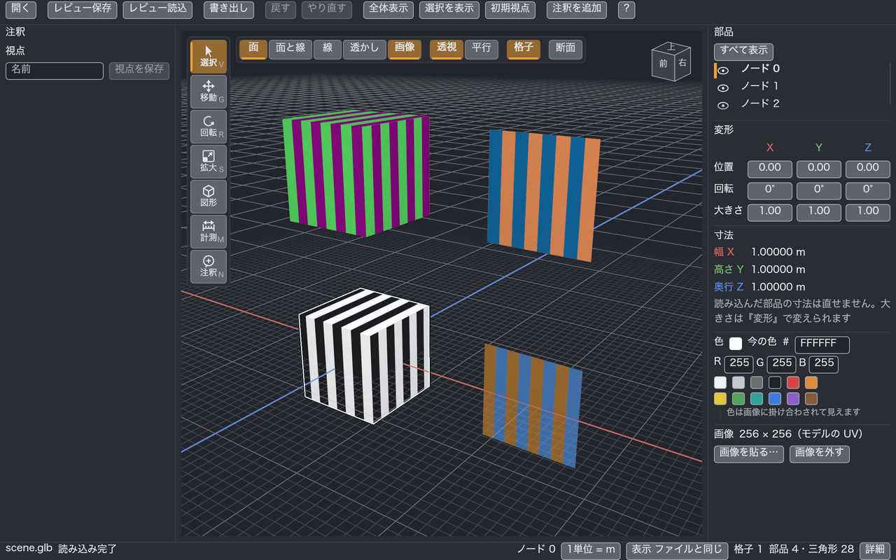
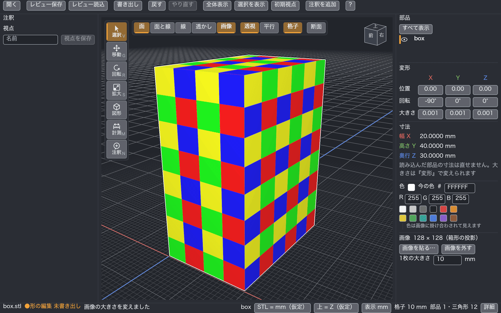

# 12　画像を貼る

木目やラベルなどの PNG・JPEG を、選んだ部品とその子にまとめて貼れます。貼った結果を渡すときは「書き出し」で GLB に保存します。

## GLB に入っている画像を見る

1. 基本色の画像が入った GLB を開きます。形が先に現れ、画像は届いた面から表示されます。下の状態欄で読み込みの進み具合を確認できます。
2. 3Dビュー上端で「面」を選びます。「画像」を押すたびに、画像を表示した状態と基本色だけの状態を比べられます。初期設定のキーは Shift+T です。
3. 画像の付いた部品を選び、右の「画像」を見ます。「モデルの UV」は、モデルに保存された座標で画像の位置と向きが決まる貼り方です。

## STL の箱に貼って大きさを決める

1. [見本の STL](../../assets/samples/review-sample.stl) を開き、右の「部品」で箱を選びます。自分で追加した図形でも同じ手順で貼れます。
2. 右の「画像を貼る…」を押して PNG・JPEG を選びます。画像ファイルをウィンドウへドロップするか、Cmd+T（Windows・Linux は Ctrl+T）で選んでも貼れます。
3. 「画像」に「箱形の投影」と出ます。画像は縦横比を保ったまま、面の向きに合わせて繰り返します。どの面でも、部品の外形の中心が画像の中心に来ます。「1枚の大きさ」は画像の長い辺の長さで、初期値は選んだ範囲の最長辺です。見本の箱を mm で開いたら、欄を押して（値全体が選ばれます）`10` と入力し、Enter を押します。画像1枚が 10 mm を占め、小さい値ほど模様が細かくなります。別の画像に貼り替えても大きさは変わりません。

4. 貼った直後の基本色は白です。画像に色を重ねるには右の「色」で見本を選びます。「画像を外す」で今の基本色だけに戻ります。貼り間違えたときは「戻す」で貼る前の画像と色に戻せます。
5. 「書き出し」で別名の GLB を保存します。画像は GLB に入り、相手に元の画像ファイルを添える必要はありません。箱形で貼った面も、開き直すと「モデルの UV」になります。「1枚の大きさ」は書き出し前に合わせてください。

## 画像が見えないとき

- 「面」または「面と線」を選び、上端の「画像」を入れます。画像の表示を切っても貼り方は残ります。
- 元の GLB に画像があるのに見えないときは、状態欄の「簡略表示」を開きます。外部参照や未対応の形式、貼るための座標がない面など、省いた理由が分かります。[GLB と画像の対応範囲](../glb.md)
- 「画像を貼る…」を押せないときは、面のある部品を選び、読み込み・書き出しが終わるのを待ちます。押せないボタンにポインタを載せると理由が出ます。
- 貼っている途中は、書き出しとレビュー保存ができません。状態欄に「画像を貼りました」と出てから操作します。
