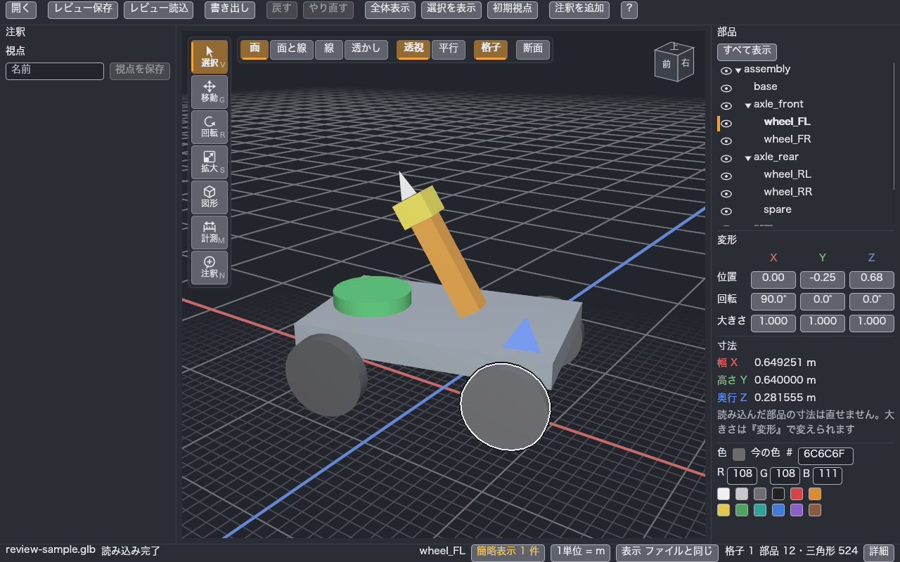

This guide is in Japanese. For an English overview, see the [project README](../../README.md).

# model-reviewer の使い方

GLB や STL の部品を選んで、寸法を測り、気になる場所に注釈を付けられます。空の画面から図形を組み、色を付けることもできます。形と色は GLB に、注釈・視点・非表示の部品はレビューという別のファイルに保存します。

部品の頂点や面の形は編集できません。テクスチャ（表面に貼る画像）の表示・編集、STL への書き出しにも対応していません。

## したいことから選ぶ

| したいこと | 手順 |
|---|---|
| 初めて起動して、見本を開く | [01 起動と終了](01-start.md) |
| 空の画面から作って、動かし、色を付ける | [11 新規作成から書き出しまで](11-create.md) |
| 受け取ったモデルを回し、部品を探す | [02 開く・見る](02-open-view.md) |
| STL の向きや長さを合わせる | [05 STL を開く](05-stl.md) |
| 角と角の距離を知る | [03 距離を測る](03-measure.md) |
| 部品の内側を見て測る | [04 断面を見る](04-section.md) |
| 寸法を指定して図形を足す | [06 図形と寸法](06-shapes.md) |
| 気になる箇所を記録して渡す | [07 注釈と視点を保存する](07-review.md) |
| 編集したモデルを GLB にする | [08 書き出し](08-export.md) |
| キーを調べる・変える | [09 ショートカットの設定](09-shortcuts.md) |
| 画面や数値が予想と違う | [10 困ったとき](10-troubleshooting.md) |

## 画面のどこを使うか

1. 「開く」で [台車の見本](../../assets/samples/review-sample.glb) を選びます。
2. 右の「部品」で車輪の名前 `wheel_FL` を押します。中央の車輪が選ばれ、右に寸法と色が出ます。

| 場所 | ここでできること |
|---|---|
| 上のボタン | 「開く」「レビュー保存」「書き出し」「戻す」。右端の「?」で操作を調べる |
| 中央の3Dビュー | モデルを回す。左端で道具、上端で表示、右上の立方体で向きを選ぶ |
| 左のパネル | 「注釈」の本文を読む・直す。「視点」に名前を付けて残す |
| 右のパネル | 「部品」から選ぶ。「変形」「寸法」「色」を変え、「計測」の結果を読む |
| 下の状態欄 | ファイル名、未保存の印、単位、操作中の案内を確かめる |

## うまくいかないとき

画面を動かして確かめた環境は macOS（Apple Silicon）だけです。Windows と Linux の画面と、この手順書の撮影結果は未確認です。症状ごとの対処は [10 困ったとき](10-troubleshooting.md)、これまでに確認した環境と条件は[検証の記録](../verify.md)にあります。
